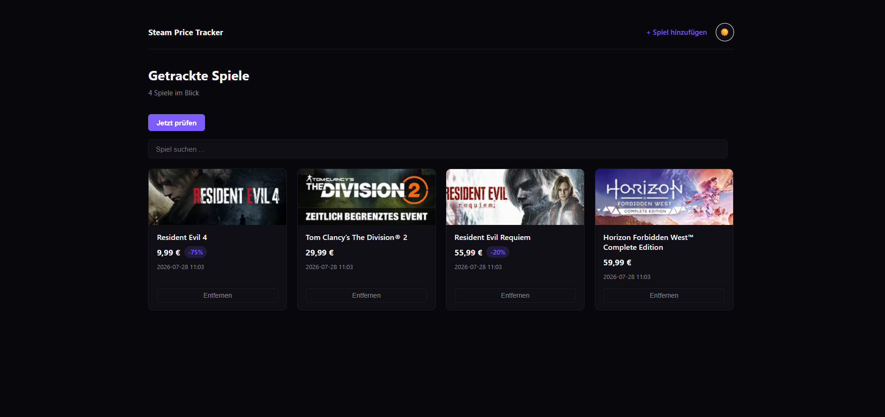

# Steam Price Tracker

[](https://github.com/VampireNoob/Steam-Price-Tracker/actions/workflows/tests.yml)
[](https://github.com/VampireNoob/Steam-Price-Tracker/actions/workflows/audit.yml)

A small application built as a school project to practice Python fundamentals: connecting to an external API, persisting data, sending notifications, and testing. It tracks the Steam prices of a user-defined list of games and sends a Telegram message whenever a price changes. It can be controlled from three independent places — the terminal, Telegram, or a browser — all working on the same data.



## Features

- **Price check** (`price_tracker.py`) — fetches the current price of every tracked game via Steam's store API, compares it with the last known price (SQLite history in `prices.db`) and sends a Telegram message if it went up or down. A newly added game gets its first price immediately, so it never sits at "not checked yet".
- **Telegram bot** (`bot_listener.py`) — runs continuously and reacts to commands:

  | Command | What it does |
  |---|---|
  | `/list` | tracked games with their latest price and discount |
  | `/add <name>` | searches Steam; reply with the number of the match to add it |
  | `/remove <number>` | removes a game (number from `/list`) |
  | `/check` | runs a price check in the background and reports when it is done |
  | `/help`, `/start` | command overview |

  Commands are case-insensitive and tolerate an `@BotName` suffix. Only the configured chat ID is served; messages from anyone else are ignored and logged.
- **Web interface** (`app.py`, Flask) — a card view of the tracked games: thumbnail, current price, discount badge and the time of the last check in local time. Live search filter, light/dark theme toggle (remembered in the browser), add games via Steam search, remove them, and trigger a manual price check. Runs at `http://127.0.0.1:5000` (the interface is in German).
- **Console menu** (`manage_games.py`) — list, add and remove games from the terminal.
- **Automation** — the price check and the bot run unattended via Windows Task Scheduler (see below).
- **Shared code** (`common.py`) — configuration, reading/writing `games.json`, Steam search, Telegram sending and helpers, so the console, the bot and the web interface use the same logic instead of three copies.

## Security and reliability

This is a single-user tool for a private machine, not a public service: there is no login, so it is not meant to be exposed to the internet.

**Security**
- The web interface only listens on `127.0.0.1`, debug mode is off by default, and requests from other websites (CSRF) are rejected.
- Form input is validated, game names are escaped (and JSON-encoded inside JavaScript), and image URLs are limited to Steam's own CDN.
- The bot token never ends up in logs or error output, Telegram messages are plain text, and the bot only answers the configured chat ID.
- Secrets live in `.env`, which is not in git. Dependabot proposes dependency and GitHub Actions updates, and a weekly `pip-audit` checks the runtime dependencies for known vulnerabilities.

**Reliability**
- `games.json` is written atomically. Invalid entries are skipped and logged; a completely broken file is set aside as `games.json.broken` instead of being overwritten.
- Unexpected Steam responses (HTML instead of JSON, odd data shapes) do not crash the price check, and one failing game does not stop the others.
- The bot survives errors while handling a message, waits 5 to 60 seconds between failed attempts when Telegram is unreachable, discards messages that arrived while it was offline (so an old `/remove` can't hit a different game later), and runs `/check` in a background thread so it stays responsive.
- Logs rotate: `tracker.log` (price checks) and `bot.log` (bot). The check time is shown in local time instead of UTC.

## Setup

1. Clone the repository, create a virtual environment and install the dependencies:
   ```bash
   git clone https://github.com/VampireNoob/Steam-Price-Tracker.git
   cd Steam-Price-Tracker
   python -m venv venv
   .\venv\Scripts\Activate.ps1
   pip install -r requirements.txt
   ```
2. Create a Telegram bot via **@BotFather** (`/newbot`) and copy the token it gives you.
3. Send your new bot any message, then open `https://api.telegram.org/bot<YOUR_TOKEN>/getUpdates` in a browser to find your chat ID (`"chat":{"id": ...}`).
4. Copy `.env.example` to `.env` and fill in `TELEGRAM_BOT_TOKEN` and `TELEGRAM_CHAT_ID`. Optionally set `FLASK_SECRET_KEY`; without it a random key is generated on every start.
5. Pick any entry point:
   - `python manage_games.py` — console menu
   - `python bot_listener.py` — Telegram bot (`/help` for commands)
   - `python app.py` — web interface at `http://127.0.0.1:5000`
6. `python price_tracker.py` — checks prices once. The first run per game only records a baseline (no notification); later runs report changes.

> `games.json` is created automatically the first time you add a game through any entry point. `games.example.json` shows the expected format.

### Running unattended (Windows Task Scheduler)

- **Price check**: daily trigger → Action: `venv\Scripts\python.exe` with argument `price_tracker.py`, "Start in" set to the project folder.
- **Bot**: "At log on" trigger → Action: `venv\Scripts\pythonw.exe` (no console window) with argument `bot_listener.py`, same "Start in" folder. Under the task's Settings tab, disable "Stop the task if it runs longer than X days" so it isn't killed after a few days.

The bot starts when you log on to Windows, not at boot, and stops when you log off.

## Project structure

```
Steam-Price-Tracker/
├── app.py                     Flask web interface (routes, CSRF protection, validation)
├── bot_listener.py            Telegram bot (long polling, commands, background check)
├── common.py                  shared code: config, games.json, Steam search, Telegram, helpers
├── manage_games.py            console menu
├── price_tracker.py           price check (SQLite history, Telegram alerts, logging setup)
├── templates/                 Jinja2 templates
│   ├── base.html              layout, navigation, theme toggle
│   ├── index.html             game cards, search filter
│   └── add.html               Steam search and add
├── static/
│   ├── style.css              light/dark theme and card layout
│   └── favicon.ico
├── tests/                     pytest suite (Steam and Telegram are mocked)
│   ├── conftest.py            blocks real HTTP requests in all tests
│   ├── test_bot_background.py /check runs in the background, one at a time
│   ├── test_bot_backoff.py    waiting between failed attempts
│   ├── test_bot_commands.py   command parsing, handlers, access control
│   ├── test_bot_logging.py    bot.log
│   ├── test_bot_resilience.py survives errors and malformed responses
│   ├── test_bot_startup.py    discards messages from the offline time
│   ├── test_common.py         games.json, Steam search, latest price
│   ├── test_game_list.py      shared add/remove logic
│   ├── test_games_file.py     validation of games.json
│   ├── test_instant_price.py  price lookup when a game is added
│   ├── test_local_time.py     local time display
│   ├── test_logging_setup.py  logging is configured by the entry points only
│   ├── test_price_logic.py    price-change detection, Steam price parsing
│   ├── test_robustness.py     malformed Steam responses, atomic saving
│   ├── test_run.py            end-to-end price check
│   └── test_security.py       CSRF, XSS, input validation, no token in logs
├── .github/
│   ├── workflows/
│   │   ├── tests.yml          runs pytest on every push and pull request
│   │   └── audit.yml          weekly pip-audit of the runtime dependencies
│   └── dependabot.yml         weekly dependency and GitHub Actions updates
├── requirements.txt           runtime dependencies
├── requirements-dev.txt       runtime + test tooling
├── pytest.ini
├── .env.example               template for your secrets
├── games.example.json         example of the games list format
└── screenshot-web.png
```

Local data files (not in git): `.env`, `games.json`, `prices.db`, `tracker.log`, `bot.log`.

## Tests and CI

`pytest` runs an automated test suite. No network access or credentials are needed: Steam and Telegram are mocked, and real HTTP requests are blocked in all tests.

- price-change detection and the Telegram message built from it
- Steam API parsing, including regression tests for malformed responses (HTML instead of JSON, bundles that return `"data": []`)
- the bot: command parsing, access control, error handling, backoff, background price check, startup behavior
- the web interface: CSRF protection, input validation, XSS-safe templates, local time display
- `games.json` handling: validation, atomic writes, broken files, add/remove logic
- logging setup (importing a module never configures logging or writes log files)

```bash
pip install -r requirements-dev.txt
pytest
```

GitHub Actions runs the tests on every push and pull request, and a weekly workflow audits the runtime dependencies with `pip-audit`.

## Development notes

- For auto-reload while working on the web interface: `$env:FLASK_DEBUG="1"; python app.py` (PowerShell).
- Don't generate the requirements files with `pip freeze`; that would mix runtime and tooling packages again. Edit them by hand or let Dependabot propose updates.
- The bot and the web interface load code at start, so restart them after changing the code.

## Why Steam only (not Instant Gaming or others)

Steam has a public, if unofficial, JSON API for both game search and price lookups, which made this project reliable without needing to scrape and parse HTML. Instant Gaming and similar shops don't offer anything comparable — supporting them would mean scraping their website directly, which is more fragile (breaks on layout changes), potentially against their terms of service, and out of scope for this project. Because the API is unofficial, it could change without notice.

## Cloud hosting — considered, deliberately not pursued

Cloud hosting was evaluated but consciously left out of scope for this version:

- **GitHub Pages / Netlify** can't run Python at all, so they were never an option.
- **Render's free tier** spins down after 15 minutes of inactivity — not acceptable for a bot that should always respond.
- **PythonAnywhere's free tier** stays always-on, but restricts outbound requests to a fixed allowlist of domains that doesn't include Steam's store API — the core of this project wouldn't work there.
- A shared cloud database (e.g. Supabase) would solve the underlying problem of keeping local, scheduled, and hosted instances in sync, but wasn't worth adding a third Supabase project for this specific use case.

Running locally (PC + Windows Task Scheduler) turned out to be the more practical fit: no hosting limitations, no added infrastructure, and the project's actual purpose — personal, always-current price tracking — is fully served by that. Anyone curious is welcome to clone the repo and run it themselves.

## Tech stack

Python, Flask (web interface), `requests` (HTTP), `python-dotenv` (config), SQLite (price history), Steam Store API (search + price data), Telegram Bot API (notifications + interactive commands), Windows Task Scheduler (automation), Python `logging` (rotating logs), `pytest` (tests), GitHub Actions, Dependabot and `pip-audit` (CI and dependency hygiene).

## Contact

Feel free to reach out via GitHub or Instagram:
- GitHub: [@VampireNoob](https://github.com/VampireNoob)
- Instagram: [@vampirenoob](https://www.instagram.com/vampirenoob/)